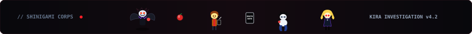
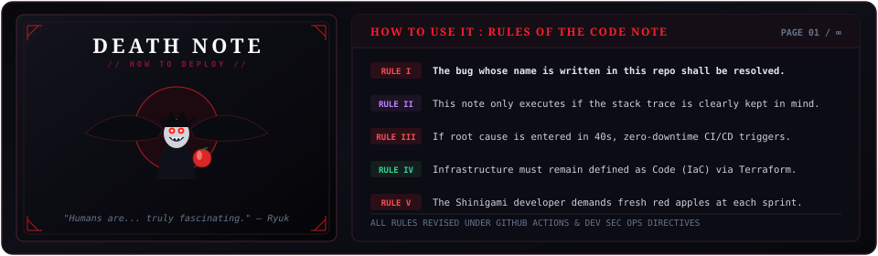
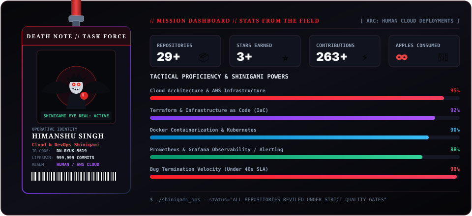
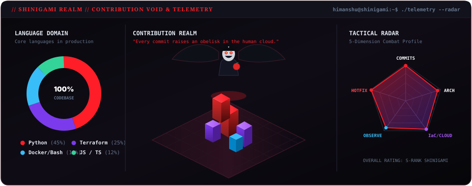
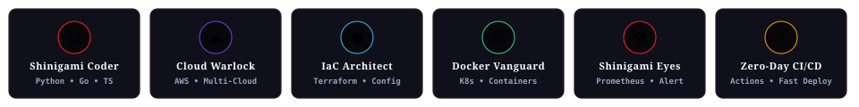
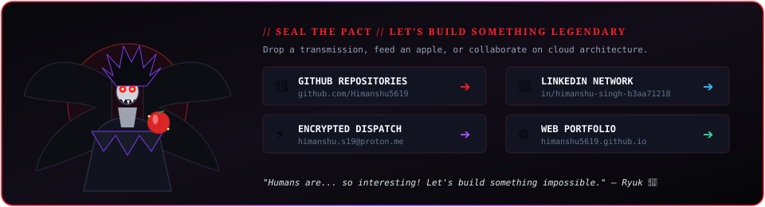

<!-- ==================== HERO SECTION: SHINIGAMI REALM OS ==================== -->

  

<!-- Quick Interactive Action Links / Death Note Badges -->

  
  
  
  
  <a href="https://komarev.com/ghpvc/?username=Himanshu5619&label=SHINIGAMI%20EYES&color=FF1E27&style=for-the-badge" alt="Views" />

<!-- ==================== ANIMATED CHIBI PARADE RIBBON ==================== -->

 

---

<!-- ==================== SECTION 1: HOW TO USE IT // THE RULES OF THE CODE NOTE ==================== -->

### `himanshu@shinigami:~$ cat /rules/how_to_use_it.md`

 

---

<!-- ==================== SECTION 2: TOOLS I FIGHT WITH // JUTSU ARSENAL ==================== -->

### `himanshu@shinigami:~$ ./arsenal --inspect-all`

 

<!-- Official Brand Icon Grid (SkillIcons) -->

 

---

<!-- ==================== SECTION 3: STATS FROM THE FIELD // SHINIGAMI DOSSIER ==================== -->

### `himanshu@shinigami:~$ ./dossier --active-investigation`

 

---

<!-- ==================== SECTION 4: S-RANK MISSIONS // DEATH NOTE INVESTIGATIONS ==================== -->
### `himanshu@shinigami:~$ ls -la /death_note/s_rank_missions`

<table border="0" width="100%" cellspacing="0" cellpadding="0" style="max-width: 960px; border-collapse: collapse; border: 1.5px solid #381B26; border-radius: 12px; overflow: hidden; background: #0A0A10;">
  <!-- Table Header -->
  <tr style="background: #140E18; border-bottom: 1.5px solid #381B26;">
    <th align="left" style="padding: 14px 16px; color: #FF1E27; font-family: 'Cinzel', serif; font-size: 13px; letter-spacing: 1.5px;">MISSION / REPO</th>
    <th align="left" style="padding: 14px 16px; color: #E2E8F0; font-family: monospace; font-size: 12px;">INVESTIGATION BRIEF</th>
    <th align="left" style="padding: 14px 16px; color: #A855F7; font-family: monospace; font-size: 12px;">JUTSU USED</th>
    <th align="center" style="padding: 14px 16px; color: #F59E0B; font-family: monospace; font-size: 12px;">RANK</th>
  </tr>

  <!-- Case 1: Cloud-Cost-Optimizer -->
  <tr style="border-bottom: 1px solid #1E1524;">
    <td style="padding: 14px 16px;">
      <a href="https://github.com/Himanshu5619/Cloud-Cost-Optimizer" style="color: #FF4D55; font-weight: bold; text-decoration: none; font-size: 14px;">
        ☁️ Cloud-Cost-Optimizer
      </a>
    </td>
    <td style="padding: 14px 16px; color: #94A3B8; font-size: 13px; line-height: 1.5;">
      Automated AWS cloud resource utilization auditor terminating zombie workloads &amp; cutting compute expenditure.
    </td>
    <td style="padding: 14px 16px;">
      <code>Terraform</code> <code>AWS</code> <code>Python</code> <code>IaC</code>
    </td>
    <td align="center" style="padding: 14px 16px; color: #F59E0B; font-weight: bold; font-size: 12px;">
      ★ S-RANK
    </td>
  </tr>

  <!-- Case 2: Docker-Container -->
  <tr style="border-bottom: 1px solid #1E1524;">
    <td style="padding: 14px 16px;">
      <a href="https://github.com/Himanshu5619/Docker-Container" style="color: #38BDF8; font-weight: bold; text-decoration: none; font-size: 14px;">
        🐳 Docker-Container Showcase
      </a>
    </td>
    <td style="padding: 14px 16px; color: #94A3B8; font-size: 13px; line-height: 1.5;">
      Multi-container orchestration blueprint demonstrating layered caching, distroless builds, and microservices security.
    </td>
    <td style="padding: 14px 16px;">
      <code>Docker</code> <code>Linux</code> <code>Microservices</code>
    </td>
    <td align="center" style="padding: 14px 16px; color: #F59E0B; font-weight: bold; font-size: 12px;">
      ★ S-RANK
    </td>
  </tr>

  <!-- Case 3: fastapi--dockerize -->
  <tr style="border-bottom: 1px solid #1E1524;">
    <td style="padding: 14px 16px;">
      <a href="https://github.com/Himanshu5619/fastapi--dockerize" style="color: #34D399; font-weight: bold; text-decoration: none; font-size: 14px;">
        ⚡ FastAPI Docker CI/CD
      </a>
    </td>
    <td style="padding: 14px 16px; color: #94A3B8; font-size: 13px; line-height: 1.5;">
      Automated pipeline triggering test-driven container compilation and zero-downtime container registry push via Actions.
    </td>
    <td style="padding: 14px 16px;">
      <code>FastAPI</code> <code>Docker</code> <code>CI/CD</code> <code>Actions</code>
    </td>
    <td align="center" style="padding: 14px 16px; color: #F59E0B; font-weight: bold; font-size: 12px;">
      ★ S-RANK
    </td>
  </tr>

  <!-- Case 4: Prometheus & Grafana Observability -->
  <tr>
    <td style="padding: 14px 16px;">
      <a href="https://github.com/Himanshu5619/MonitoringWithPrometheusAndGrafana" style="color: #A855F7; font-weight: bold; text-decoration: none; font-size: 14px;">
        📈 Prometheus &amp; Grafana Observability
      </a>
    </td>
    <td style="padding: 14px 16px; color: #94A3B8; font-size: 13px; line-height: 1.5;">
      Full-spectrum telemetry architecture harvesting Linux daemon metrics, Alertmanager routing, and real-time dashboards.
    </td>
    <td style="padding: 14px 16px;">
      <code>Prometheus</code> <code>Grafana</code> <code>DevOps</code> <code>Linux</code>
    </td>
    <td align="center" style="padding: 14px 16px; color: #F59E0B; font-weight: bold; font-size: 12px;">
      ★ S-RANK
    </td>
  </tr>
</table>

  <a href="https://github.com/Himanshu5619?tab=repositories" style="color: #FF1E27; font-family: monospace; font-size: 12.5px; text-decoration: none; font-weight: bold;">
    ➔ See all 29+ Death Note investigations in the repository archives ➔
  </a>

 

---

<!-- ==================== SECTION 5: THE SHINIGAMI REALM (CONTRIBUTION MATRIX & ANALYTICS) ==================== -->

### `himanshu@shinigami:~$ ./telemetry --contribution-void`

  

<!-- GitHub Streak Stats (Ryuk Death Note Crimson Theme) -->

  

<!-- Dual Stats & Top Languages (Shinigami Void Palette) -->
<table border="0" width="100%" style="max-width: 960px;">
  <tr>
    <td width="50%" align="center" valign="middle">
      
    </td>
    <td width="50%" align="center" valign="middle">
      
    </td>
  </tr>
</table>

 

<!-- Shinigami Trophies & Achievements Matrix -->

 

---

<!-- ==================== SECTION 6: SEAL THE PACT // SUMMON THE SHINIGAMI ==================== -->

### `himanshu@shinigami:~$ ./seal_pact`

 

  
  
  
  

  "Humans are... truly fascinating! Let's build something extraordinary together." — Ryuk 🍎

